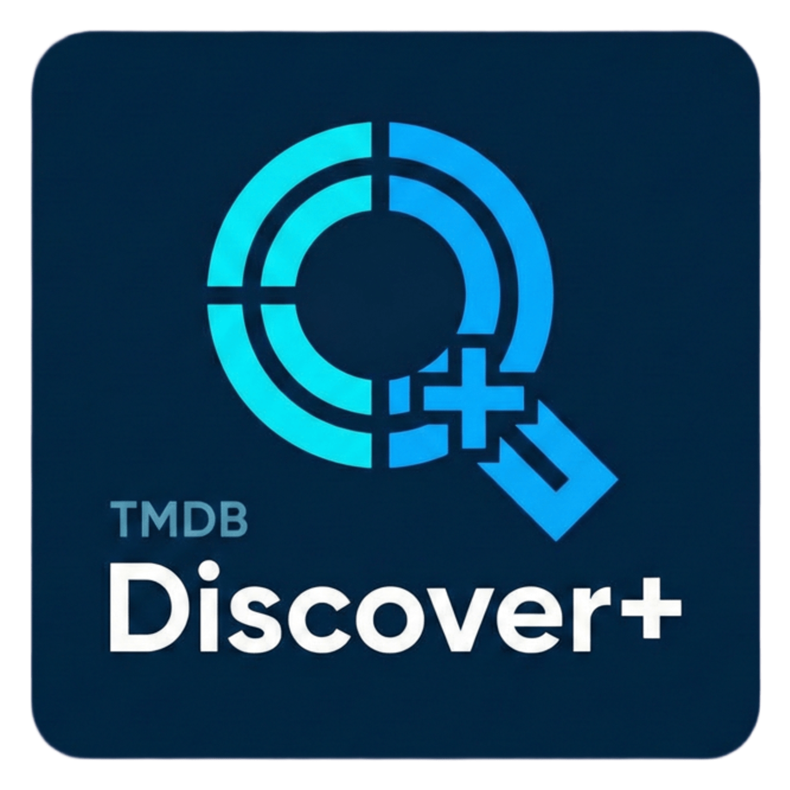
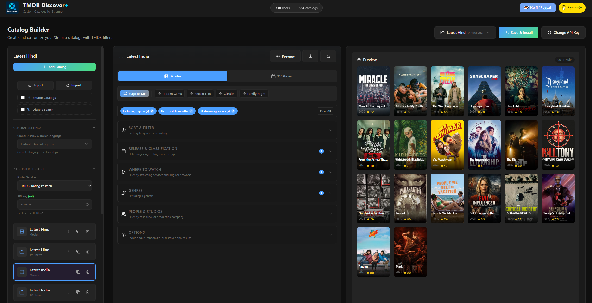

<p align="center">
  
</p>

<h1 align="center">TMDB Discover+</h1>

<p align="center">
  <strong>Create personalized movie, TV, and anime catalogs for Stremio.</strong><br/>
  Discover with TMDB, IMDb, AniList, MyAnimeList, Kitsu, and Simkl.
</p>

<p align="center">
  <a href="https://github.com/semi-column/tmdb-discover-plus/releases/latest">
    
  </a>
  <a href="https://discord.gg/X2N3btmEG2">
    
  </a>
  <a href="https://nodejs.org/">
    
  </a>
  <a href="https://ko-fi.com/semicolumn">
    
  </a>
</p>

TMDB Discover+ is a **catalog and metadata addon**, not a streaming provider.
Build and preview catalogs, save multiple configurations, and install the
configured addon in Stremio. You need separate stream addons to watch content.

<p align="center">
  
</p>

## Contents

- [Quick start](#quick-start)
- [Features](#features)
- [Usage and configuration recovery](#usage-and-configuration-recovery)
- [Self-hosting](#self-hosting)
- [Configuration](#configuration)
- [Admin dashboard](#admin-dashboard)
- [API overview](#api-overview)
- [Development](#development)
- [Troubleshooting](#troubleshooting)
- [Contributing and support](#contributing-and-support)
- [License and credits](#license-and-credits)

## Quick start

The recommended public stable instance is
**[tmdb-discover-plus.elfhosted.com](https://tmdb-discover-plus.elfhosted.com/)**.
No server installation is needed.

1. Get a TMDB API key from [TMDB account settings](https://www.themoviedb.org/settings/api).
2. Open the instance and sign in with that key.
3. Create a configuration or select an existing one, then add catalogs.
4. Choose a source, set its filters, and preview the results.
5. Use **Save & Install** to save and install the configured addon in Stremio.

Use your configuration's install link, not the bare `/manifest.json`.
The root manifest is a setup entry point and advertises no catalog or metadata
resources.

## Features

### Multiple catalog sources

| Source            | Examples                                                                                                    |
| ----------------- | ----------------------------------------------------------------------------------------------------------- |
| TMDB              | Discover filters, trending/popular and release lists, collections, studios                                  |
| IMDb              | Search, rankings, lists, and source-specific filters when the instance has a compatible IMDb API configured |
| AniList           | Anime discovery and source-specific filtering                                                               |
| MyAnimeList (MAL) | Anime catalogs; API-backed functionality can use an instance or user client ID                              |
| Kitsu             | Anime discovery and filtering                                                                               |
| Simkl             | Source-specific catalogs using an instance or user API key                                                  |

Available functionality depends on the source and credentials configured on the
instance/account. See the [environment reference](docs/environment.md) for
optional source services and credentials.

### Build catalogs your way

- Include/exclude genres, keywords, people, and production companies.
- Filter by year/date, rating, vote count, runtime, language, country, region,
  and watch provider where the selected source supports them.
- Use dynamic date presets and randomization for changing discovery results.
- Preview results before installation; reorder and manage catalogs in the builder.
- Save and switch between multiple addon configurations.
- Export selected catalogs and preferences to JSON, then import into another
  configuration or account.
- Discover and share public catalogs through the marketplace.
- Customize artwork with the supported providers, including RPDB, TOP Posters,
  and Fanart.tv; availability depends on provider credentials.

Filters are source-specific: not every TMDB option exists for every source.
IMDb ID support and metadata integration help catalogs work with other Stremio
addons.

### Operate your own instance

- PostgreSQL or MongoDB persistence; explicit in-memory mode for evaluation.
- Redis or in-process caching.
- Container images and source-based deployment.
- Optional protected admin dashboard with request/error/upstream investigation,
  live tail, usage, cache analytics/TTLs, and system diagnostics.

## Usage and configuration recovery

Sign in with your TMDB API key to manage its configurations. Select a saved
configuration to edit it or create another. Saving updates a configuration;
manifest/catalog changes may also require refreshing or reinstalling the addon
in Stremio because clients cache manifests and results.

### Export and import

Use the builder's export/import controls to choose catalogs and optionally
preferences and the configuration name. Exported JSON does **not** contain API
keys. After importing, supply any credentials needed by the destination
account/providers, review the catalogs, then save/install.

Exports can still contain private catalog names, filters, and preferences:
review them before sharing. They are configuration transfers, not complete
server/database backups.

### Invalid TMDB API key

If TMDB confirms that a key is invalid, configured manifests, catalogs,
metadata, and authenticated configuration operations return **401** rather than
cached successful content. Signing in/verifying with the invalid key opens an
export-only recovery view for associated saved configurations when available.

Export there, sign in with a valid key, then import into a new account/configuration.
Recovery does not authorize editing, installing, or fetching addon content with
the rejected key. A temporary TMDB failure is not treated as confirmed key
invalidation. Key-validity checks use a short shared-cache window (currently
60 seconds); revocation detection is not instantaneous, and already cached
client/CDN responses cannot be recalled.

## Self-hosting

See the **[complete self-hosting guide](docs/self-hosting.md)** for a persistent
PostgreSQL + Redis Compose example, manual installation, external databases,
HTTPS/reverse proxies, admin setup, backups, upgrades, and troubleshooting.

### Container image

```bash
docker pull ghcr.io/semi-column/tmdb-discover-plus:latest
```

Stable images are published for AMD64 and ARM64. Pin a published version tag
(without its release's leading `v`) or digest for controlled upgrades.
An image alone still needs application secrets and a storage/cache choice;
follow the guide rather than running it with placeholder credentials.

### Source installation

```bash
git clone https://github.com/semi-column/tmdb-discover-plus.git
cd tmdb-discover-plus
npm ci
npm --prefix server ci
npm --prefix client ci
cp .env.example .env
```

**Before starting:** edit `.env`, generate separate `JWT_SECRET` and
`ENCRYPTION_KEY` values, and configure reachable database/cache services. For a
disposable local test only, explicitly use memory drivers and clear Redis URLs.

```bash
npm --prefix client run build
npm start
```

The built frontend and API are served at `http://localhost:7000` unless `PORT`
is changed. Use HTTPS and a supervised production process for remote access.
The [development workflow](#development) below is separate.

> The existing `docker-compose.yml` starts both databases and publishes their
> ports. `docker-compose.production.yml` and `Caddyfile` are a bespoke DuckDNS
> setup, **not ElfHosted's deployment configuration**. Use the
> [documented self-hosting example](docs/self-hosting.md#docker-compose-postgresql--redis)
> rather than assuming either is a production-ready default.

## Configuration

[`.env.example`](.env.example) is a starting template;
[docs/environment.md](docs/environment.md) explains runtime defaults, driver
selection, source options, and admin/observability settings. Placeholder secrets
are not usable credentials.

| Setting                                             | Purpose                                                                                         |
| --------------------------------------------------- | ----------------------------------------------------------------------------------------------- |
| `JWT_SECRET`                                        | Required signing/account-identity secret; generate a strong value of at least 32 characters     |
| `ENCRYPTION_KEY`                                    | Required 64-character hexadecimal encryption key; preserve it with database backups             |
| `DATABASE_DRIVER` + `POSTGRES_URI` or `MONGODB_URI` | Choose durable configuration storage                                                            |
| `CACHE_DRIVER` + `REDIS_URL`                        | Choose Redis or memory caching                                                                  |
| `PORT`                                              | App listen port; set explicitly in standalone containers                                        |
| `BASE_URL`                                          | Public origin used in generated links                                                           |
| `TRUST_PROXY`                                       | Trust only your actual proxy topology; `0` for direct access                                    |
| `TMDB_API_KEY`                                      | Optional server default for background/shared TMDB work; users still sign in with their own key |
| `ADMIN_USERNAME` + admin password/hash              | Enable protected admin access and observability                                                 |

Memory storage loses configurations on restart. A provider-supplied
`DATABASE_URL` must be mapped to `POSTGRES_URI`; it is not a substitute for the
application's database URI setting. Variables in a Compose `.env` are not
automatically container environment variables unless forwarded.

## Admin dashboard

Set `ADMIN_USERNAME` and either `ADMIN_PASSWORD` (minimum 16 characters) or
`ADMIN_PASSWORD_HASH`, restart/recreate the app, then open `/admin`.
Admin is disabled by default. Generate an optional hash with:

```bash
npm --prefix server run admin:hash
```

The dashboard offers:

- **Overview / Requests:** rates, latency, request filters, traces, and history.
- **Errors / Dependencies / Live tail:** grouped failures and captured upstream work.
- **Usage:** traffic and configuration/catalog insights.
- **Caching:** lookup hit/miss percentages, request outcomes, miss-heavy
  routes/paths, and a read-only inventory of current TTL policy.
- **System / Proxy diagnostics / Security:** process health, ingress diagnostics,
  and optional TOTP setup.

Cache lookup rates are not request-level cache rates. One request can have hits,
misses, and API calls together; the dashboard shows both views and explains
their limits. Admin collection/history uses existing database/Redis services,
or bounded process memory. See [setup and retention guidance](docs/self-hosting.md#admin-dashboard-and-cache-analytics).

## API overview

See [docs/api.md](docs/api.md) for authentication, errors, route tables, and
examples; [docs/architecture.md](docs/architecture.md) describes the implementation.

| Endpoint                                            | Purpose                                                           |
| --------------------------------------------------- | ----------------------------------------------------------------- |
| `GET /health`                                       | Runtime/cache/degradation diagnostics                             |
| `GET /ready`                                        | Readiness status                                                  |
| `GET /api/status`                                   | Version/build/runtime and storage/cache information               |
| `POST /api/auth/login`                              | Authenticate a TMDB key; invalid-key recovery uses a 401 response |
| `/api/config` and `/api/config/:userId`             | Authenticated configuration management                            |
| `GET /manifest.json`                                | Configuration-required entry point, no advertised resources       |
| `GET /:userId/manifest.json`                        | Configured Stremio manifest                                       |
| `GET /:userId/catalog/:type/:catalogId.json`        | Catalog results                                                   |
| `GET /:userId/catalog/:type/:catalogId/:extra.json` | Catalog with extras/pagination                                    |
| `GET /:userId/meta/:type/:id.json`                  | Metadata                                                          |
| `GET /:userId/meta/:type/:id/:extra.json`           | Metadata with extras                                              |

Configured addon URLs identify a saved configuration; they are not bearer-token
configuration-editing endpoints. Do not share links or configuration data you
intend to keep private. Root-level `/meta/*` and `/catalog/*` calls are
unsupported and return 404.

## Development

Install Node.js 22.16+ (Node.js 24 recommended) and the root/server/client
dependencies, then create and configure the root `.env` as above.
Set `NODE_ENV=development` and `TRUST_PROXY=0` for direct local testing.

Run the backend **from the repository root**:

```bash
node --env-file=.env --experimental-strip-types --watch server/src/index.ts
```

In another terminal:

```bash
npm run dev:client
```

- Builder: `http://localhost:5173`
- Admin UI in Vite: `http://localhost:5173/admin.html`
- API/backend: `http://localhost:7000`

Vite proxies API and configured addon calls to port 7000. If you change the
backend port, update your local proxy target too. Use `BASE_URL=http://localhost:5173`
when testing generated links through Vite. Built production admin access is
`/admin`, not `/admin.html`.

The combined `npm run dev` changes directory into `server` before loading dotenv.
It therefore needs environment variables already exported or a `server/.env`.
On a POSIX shell you can use the root file without duplicating secrets:

```bash
DOTENV_CONFIG_PATH=../.env npm run dev
```

For a dependency-free local test, set `DATABASE_DRIVER=memory`,
`CACHE_DRIVER=memory`, `REDIS_URL=` and `OBS_REDIS_URL=`; this intentionally loses
data on restart. Keep real secrets even in local environments, and never commit
your `.env`.

### Checks

Run from the repository root:

```bash
npm --prefix server test
npm --prefix server run typecheck
npm --prefix client test
npm --prefix client run lint
npm --prefix client run build
```

History backend contract tests run memory coverage by default; real database
coverage requires `OBS_HISTORY_TEST_POSTGRES` and/or `OBS_HISTORY_TEST_MONGO`.
Those tests create and delete their own schema/database; use test services,
never a production database. The live integration runner starts a backend by default; use `SKIP_SERVER=1`
only when deliberately targeting an existing test server, with test credentials.
See [contributing](docs/CONTRIBUTING.md).

### Layout and stack

```text
client/src/                  React UI and admin dashboard
server/src/routes/           Express API/addon/admin routes
server/src/services/         Sources, storage/cache, observability
server/src/infrastructure/   Throttling and process-local caches
server/src/cacheTtls.ts      Shared cache policy constants
server/tests/                Vitest and live integration checks
docs/                        API, environment, architecture, hosting guides
Dockerfile.docker            Multi-stage production image
```

Backend: Node.js native TypeScript stripping, Express, PostgreSQL/MongoDB,
Redis/memory, and built-in fetch. Frontend: React, Vite, CSS, Lucide, and uPlot.
GitHub Actions runs checks and container builds; release-please manages stable
release versions and image publishing.

## Troubleshooting

| Problem                                     | Next step                                                                                                             |
| ------------------------------------------- | --------------------------------------------------------------------------------------------------------------------- |
| Missing secrets or Redis connection retries | Follow [self-hosting troubleshooting](docs/self-hosting.md#troubleshooting); check env loading and reachable services |
| Configurations missing after restart        | Confirm a durable database is actually selected, and retain the original secrets                                      |
| Invalid API key                             | Export from recovery, then sign in/import with a valid key                                                            |
| Catalogs missing in Stremio                 | Save the configuration, install its configured manifest, refresh/reinstall the addon, and preview the catalog         |
| No results                                  | Check source credentials and filter combinations; filters vary by source                                              |
| Wrong generated URL                         | Set `BASE_URL` and verify proxy host/protocol forwarding                                                              |
| Admin 404                                   | Configure admin credentials and build the frontend                                                                    |
| Bare `/meta` or `/catalog` traffic          | These old config-less installs are unsupported; ingress blocking is optional and must preserve configured paths       |

## Contributing and support

- [Contributing guide](docs/CONTRIBUTING.md)
- [Report a bug](https://github.com/semi-column/tmdb-discover-plus/issues/new?template=bug_report.yml)
- [Request a feature](https://github.com/semi-column/tmdb-discover-plus/issues/new?template=feature_request.yml)
- [GitHub Discussions](https://github.com/semi-column/tmdb-discover-plus/discussions)
- [Discord](https://discord.gg/X2N3btmEG2)
- [Security policy](docs/SECURITY.md) and [code of conduct](docs/CODE_OF_CONDUCT.md)

Use Conventional Commits (`feat:`, `fix:`, `docs:`) and do not manually bump
release-managed versions. Current issues/discussions track planned work;
export/import, templates, collections, marketplace, and admin analytics are
already implemented, not a future roadmap.

## License and credits

Licensed under [MIT](LICENSE). Thanks to our
[contributors](https://github.com/semi-column/tmdb-discover-plus/graphs/contributors),
the Stremio community, TMDB, the catalog/data/artwork providers, and
[ElfHosted](https://elfhosted.com/) for hosting the public stable instance.

TMDB Discover+ is independent and is not affiliated with or endorsed by TMDB or
Stremio. Respect provider terms, API limits, and content creators. This addon
provides discovery/metadata; playback depends on other addons.
