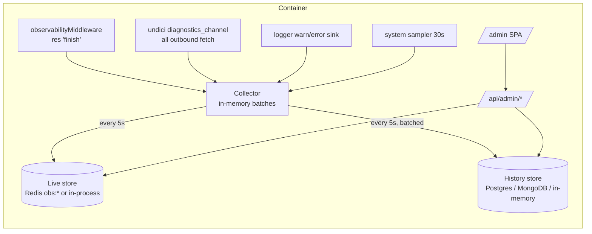

# Observability Dashboard — Design Decisions

This document records what was built for the admin observability dashboard, the decisions behind it, and what was agreed during planning. Read it before changing the dashboard, the collectors, or the `obs_*` tables.

## 1. Context and constraints

- **Deployment target:** ElfHosted runs the published Docker image. We can't reach their Postgres, Redis, or logs directly. The only thing we control is the code that ships in the image. So the app has to collect, store, and present its own telemetry.
- **Shared infrastructure:** Postgres and Redis are provided via `POSTGRES_URI` and `REDIS_URL` and are also used by the app itself. Anything we add must be cheap, bounded, and must never slow down or break user traffic.
- **Network path (verified 2026-10-26):** the `tmdb-discover-plus.elfhosted.com` DNS points to Cloudflare (104.26.x / 172.67.x), and responses carry `server: cloudflare` and `cf-ray`. The likely path is Cloudflare → ElfHosted ingress → container.
- **Replicas:** unknown whether ElfHosted runs more than one, so the design must be correct either way.
- **Open-source self-hosting (added in round 2):** anyone can run this image with Postgres **or** MongoDB **or** no database, Redis **or** in-memory cache, and usually **without** Cloudflare. The dashboard must work with whatever is present and must not trust Cloudflare headers unless told to.
- **No shell on ElfHosted:** their cron builds and deploys each release automatically. We can only set env vars, so every setup step must be possible through env vars or the dashboard itself; no CLI step can be required.

## 2. Decisions agreed with the maintainer

| Topic                                 | Decision                                                                                                |
| ------------------------------------- | ------------------------------------------------------------------------------------------------------- |
| Admin accounts                        | A single admin, configured via env vars.                                                                |
| Raw retention                         | 7 days.                                                                                                 |
| Raw sampling                          | 100% of requests stored (`OBS_SAMPLE_RATE=1`). Can be changed at runtime via env, no rebuild.           |
| Charts                                | uPlot, loaded only on `/admin`.                                                                         |
| Alerts / webhooks                     | Not wanted. Nothing pushes outside the app.                                                             |
| Browser (client-side) error reporting | Not wanted. Server-side capture only.                                                                   |
| Brute-force policy                    | Implementer's recommendation (see §5): per-IP lockout plus a global slowdown, with no hard global lock. |
| `TRUST_PROXY`                         | **Not changed.** The dashboard only diagnoses it (see §9).                                              |
| Backends                              | Support Postgres, MongoDB and no database for history; Redis or in-memory for live data.                |
| No Redis                              | Show live data for the single instance (self-hosters typically run one container), labelled as such.    |
| Admin password                        | Plain `ADMIN_PASSWORD` env var accepted (hash stays optional). No CLI step needed anywhere.             |
| Storage cap                           | `OBS_MAX_STORAGE_MB`, default 1024 MB.                                                                  |
| Sampling default                      | Stays 100% for every backend; `OBS_SAMPLE_RATE` changes it.                                             |
| Cloudflare                            | Opt-in via `TRUST_CLOUDFLARE_HEADERS=true` (set on ElfHosted).                                          |

## 3. Architecture

Code locations:

- Server collection: `server/src/services/observability/`
- Admin auth: `server/src/services/admin/auth.ts`
- Admin API: `server/src/routes/admin.ts`
- UI: `client/src/admin/` (entry point `client/admin.html`)

## 4. Decisions and rationale

### 4.1 Off unless configured

- `/admin` and `/api/admin/*` return **404** unless `ADMIN_USERNAME` and either `ADMIN_PASSWORD` (16+ chars) or `ADMIN_PASSWORD_HASH` are set. A misconfiguration (short password, malformed hash, bad TOTP secret) keeps the admin off and is logged once at startup with the reason.
- Collection follows the admin config: it runs only when the admin is configured.
- **Why:** this is a public open-source addon. Other self-hosters who pull a new image must not suddenly get new tables, Redis keys, or write load.

### 4.2 Zero impact on the request path

- **Request capture:** the middleware reads values in `res.on('finish')`, after the response has been sent. It only pushes onto in-memory batches. No I/O happens per request.
- **Flushing:** every 5s, one Redis `MULTI` and one `INSERT … SELECT FROM unnest(…)` per table. A flush never overlaps a previous one.
- **Bounded memory:** each buffer is capped at 20,000 events. Overflow is dropped and counted, and the counts are visible on the System page.
- **Failures are contained:**
  - A failed Postgres insert drops that batch, logs a warning at most once a minute, and is counted.
  - A failed Redis write is counted the same way.
  - User requests are never affected.
- **Startup is not delayed:** `initObservability()` is not awaited. Events recorded while Postgres is still initialising are buffered and written once it is ready, so the first seconds after a deploy, when regressions show up, are not lost.
- **Shutdown flushes:** graceful shutdown calls `stopObservability()` before storage disconnects, so the last batch is written.
- **Small, separate Postgres pool:** `max: 3` connections, a 20s `statement_timeout`, and `application_name=tdp-observability`. Dashboard queries can't starve the app's own pool.

### 4.3 Upstream capture via `diagnostics_channel`

- **Choice:** subscribe to undici's `undici:request:create/headers/error` channels instead of editing the TMDB, IMDb, AniList, MAL, Kitsu, and Simkl clients.
- **Why:**
  - Every `fetch()` is covered automatically, including future providers, poster services, and GitHub downloads.
  - No client code changes, so no regression risk.
  - Verified on Node 24 locally; the channels exist on the Node 22 image as well.
- **Duration measured:** time to response headers. Body download time is not included.
- **Path handling:** the query string is dropped, so API keys never reach storage. Numeric, IMDb, and hash segments are templated (e.g. `/3/movie/:id`). Error messages have `api_key=` / `token=` redacted.

### 4.4 Error tracking from the logger, not a new SDK

- **Choice:** the existing logger calls a sink for **every** `warn` and `error`, regardless of `LOG_LEVEL`. The data it passes has already been redacted by the logger's own sanitiser.
- **Fingerprint:**
  - Built as `sha1(level | context | normalised message | normalised error detail | top app stack frame)`.
  - Normalisation removes URLs, UUIDs, IMDb IDs, hex strings, quoted strings, and numbers, so the same bug with different IDs groups together.
  - The stack frame is reduced to `function@dir/file.ts` with no line numbers, so small edits don't split a group.
- **Statuses:** `open`, `resolved`, `ignored`, `regressed`. A resolved group that fires again becomes **regressed**.
- **New-version badge:** groups record `first_version` / `last_version`. The UI shows "new in vX" only once older versions exist, because on the first deploy everything is new.
- **Volume control:** group totals are exact. Individual occurrences are capped at 50 per fingerprint per 5s per instance, which keeps noisy warnings like rate-limit messages from flooding the table.
- **Request linking:** the first error logged during a request is stored on that request (`error_fp`), so the explorer can filter to "errors only" and a trace shows its errors.

### 4.5 Storage: a live store and a history store, chosen from what the app already uses

The dashboard never asks for new infrastructure. It reads the same driver decision the app made (`getStorageDriver()` for the database, `REDIS_URL`/`CACHE_DRIVER` for the cache):

| App storage  | History backend                                                           | Retention                                        |
| ------------ | ------------------------------------------------------------------------- | ------------------------------------------------ |
| Postgres     | `obs_*` tables, day partitions (`history/postgres.ts`)                    | drop whole partitions                            |
| MongoDB 4.4+ | `obs_*` collections on the app's mongoose connection (`history/mongo.ts`) | TTL indexes (`expireAfterSeconds`)               |
| none         | bounded ring buffer in memory (`history/memory.ts`)                       | last 10,000 requests (3,000 nightly) + retention |

All three implement one `HistoryStore` interface (`history/types.ts`), and filters are parsed once into a backend-neutral form, so the admin API and UI don't know which one is active. If Postgres/Mongo initialisation fails, the dashboard falls back to memory instead of turning off.

- **Live store: Redis when available, otherwise in-process**
  - `obs:m:<minute>`: global counters, latency histogram, upstream counters, per-instance counts. TTL 24h.
  - `obs:h:<hour>`: the same plus per-route, status-code, source, client, country, Cloudflare edge, and content-type breakdowns. TTL is retention + 1 day.
  - **Why the split:** high-cardinality breakdowns live only in hourly hashes, which keeps Redis memory small (minute hashes have about 80 fields).
  - `obs:u:<h|d>:…`: HyperLogLog of hashed config IDs, giving unique active configs with fixed ~12KB per key.
  - `obs:tail` (capped list) plus the `obs:live` pub/sub channel, which feed the live tail across replicas.
  - `obs:instances` / `obs:instance:<id>`: heartbeat and latest system sample per replica.
  - `obs:admin:*`: login lockout counters and revoked admin sessions.
  - Without Redis the same structures live in process memory. That is exact for one container (the normal self-hosted case); the UI says "this instance" and hides cross-instance views.
- **Postgres specifics**
  - Day partitions make retention instant and avoid the vacuum churn of deleting ~7M rows/day at 100% sampling. Partitions are created 2 days ahead every 5 minutes.
  - DDL and maintenance run under a Postgres advisory lock, so only one replica does them.
- **MongoDB specifics**
  - Plain collections (not time-series) so MongoDB 4.4 and Atlas work. Verified on 4.4 and 7.
  - Error-group upserts use a pipeline update so "resolved → regressed" is atomic; user-provided text is wrapped in `$literal` so it can't be interpreted as an operator or field path.
  - Date bucketing uses `$toLong`/`$mod` instead of `$dateTrunc` (5.0+), keeping 4.4 support.
  - Percentiles come from the same latency histogram as live data (`$percentile` needs 7.0), so they are shown as bucket upper bounds.
  - If retention changes, the TTL index is updated in place with `collMod`.
- **In-memory specifics:** per instance, lost on restart; config analytics read `getAllConfigs()` from the memory adapter. A banner states the capacity.
- **Storage cap (`OBS_MAX_STORAGE_MB`, default 1024):** self-hosters may run small databases (e.g. 512 MB Atlas free tier).
  - Every 5 minutes the dashboard measures only its own tables/collections (Postgres: `pg_total_relation_size`; Mongo: logical data + index size, because on-disk size doesn't shrink right after deletes).
  - Over the cap, whole oldest days are deleted early (never today).
  - If today alone is over the cap, new request/upstream rows are skipped (counted as `storageCap` drops) and the UI shows a red banner. Live counters and error groups keep working.
  - It never touches the app's own data. `0` disables the cap.
- **Dropped from the plan: hourly rollup table.** The hourly live buckets already cover the agreed 7 days.

### 4.6 Sampling weights

Each stored request row has `weight = 1 / OBS_SAMPLE_RATE`. Requests that are always kept (5xx, slow, or that logged an error) get weight 1. Historical counts use `sum(weight)`, so they stay correct if the sample rate is lowered later. Live counters in Redis always count 100%.

### 4.7 Privacy and data minimisation

- **Config IDs:**
  - In Stremio URLs the config ID acts like a bearer secret. It is masked to `:user` in stored paths and stored only as an HMAC (`user_hash`).
  - The explorer's "Config ID" filter hashes what you type server-side, so you can still look up the requests behind a user's bug report.
- **IPs:** never stored raw, only an HMAC (`ip_hash`), used for counting and lockout.
- **HMAC key:** derived from `ENCRYPTION_KEY`, so no new secret is needed.
- **Not stored:** query strings, request bodies, headers, and API keys. The User-Agent is kept (truncated to 256 characters) so client classification can be refined later.
- **Admin traffic** (`/admin`, `/api/admin/*`), health checks, and static assets are not recorded.
- **Unmatched paths** (scanners, SPA fallback) are grouped under the single route `(unmatched)`, so bots can't blow up route cardinality.

### 4.8 Route templating

Stremio routes (`/:userId/manifest.json`, `/:userId/catalog/...`, `/:userId/meta/...`) are recognised with regexes, which also extract:

- the **source**: from the catalog ID prefix, or the meta ID (`tt…` → imdb, `kitsu:` → kitsu, …)
- the **content type**
- the **catalog ID**

Other routes use Express's matched route template (`req.baseUrl + req.route.path`).

### 4.9 Latency percentiles

- **Live data:** percentiles come from a fixed bucket histogram (10ms … 30s). They are shown as "≤ X" because they are bucket upper bounds.
- **History:** Route performance and Endpoints use exact percentiles on Postgres (`percentile_disc`) and in-memory history; on MongoDB they are bucket upper bounds and the UI labels them so.

## 5. Admin security

- **Password, two options:**
  - **`ADMIN_PASSWORD` (plain env var, minimum 16 characters).** Added because ElfHosted builds and deploys automatically and there is no shell to run a hashing script. It is held at the same trust level as `JWT_SECRET` and `ENCRYPTION_KEY`, which are already plain env vars. Compared in constant time (SHA-256 digests + `timingSafeEqual`); never logged.
  - **`ADMIN_PASSWORD_HASH` (optional, takes precedence):** scrypt with N=2^15, r=8, p=1, a 16-byte salt and a 64-byte key via `node:crypto`. Format `scrypt:N:r:p:salt:hash` uses `:` so it pastes into env files unescaped. For people who don't want the plain password in env; `npm run admin:hash` is a convenience, not a requirement.
- **Username:** compared in constant time, and the password check always runs, so timing doesn't reveal whether the username was right.
- **Session:**
  - An HS256 JWT in an `HttpOnly; SameSite=Strict; Path=/api/admin` cookie, with `Secure` when the request is HTTPS. Default lifetime 8h.
  - The signing key is `HMAC(JWT_SECRET, username + (password hash or SHA-256 of the password))`. It is deterministic, so a session works on every replica, and **changing the password signs out every session**.
  - Logout revokes the token in the live store until it expires.
- **CSRF:**
  - Every admin request must send `X-Admin-Request: 1`. Cross-origin, that custom header forces a CORS preflight, which the existing CORS config rejects because the header isn't allowed.
  - `SameSite=Strict` adds a second layer.
- **Brute force (recommended policy):**
  - 5 failures from one client IP lock that IP for 15 minutes (429).
  - More than 20 failures across all IPs in 15 minutes add a 2s delay to every attempt.
  - **No hard global lock**, so an attacker can't lock the owner out.
  - `strictRateLimit` also applies.
- **Visitor IP and Cloudflare headers (fixed in round 2):**
  - The first version trusted `CF-Connecting-IP` whenever present. Without Cloudflare in front (most self-hosted setups) anyone could forge it, dodging the per-IP lockout and, worse, `ADMIN_ALLOWED_IPS`.
  - Now `CF-Connecting-IP`, `CF-IPCountry` and `CF-Ray` are read **only** when `TRUST_CLOUDFLARE_HEADERS=true`. Otherwise the visitor IP is Express's `req.ip` (governed by the existing `TRUST_PROXY`), and country/edge data is not collected. A unit test confirms a rotated fake header doesn't reset the lockout.
  - Proxy diagnostics flags both mistakes: Cloudflare headers present but not trusted, and trusted but absent (spoofable).
- **Optional hardening:**
  - `ADMIN_TOTP_SECRET`: RFC 6238 authenticator code, ±1 step tolerance. The **Security** page generates a secret and `otpauth://` link after login (server never stores it); the admin pastes it into the env var. No CLI needed.
  - `ADMIN_ALLOWED_IPS`: IP/CIDR allow-list via `net.BlockList`. Non-listed callers get 404.
- **Other:**
  - `admin.html` is only served at `/admin` (direct `/admin.html` is 404), with `noindex`.
  - All admin queries are parameterised; filter values go through allow-lists or bind parameters.
  - CSV export guards against spreadsheet formula injection.

## 6. Dashboard pages

| Page                   | Data source                                 | What it answers                                                                                                                                                                                                                             |
| ---------------------- | ------------------------------------------- | ------------------------------------------------------------------------------------------------------------------------------------------------------------------------------------------------------------------------------------------- |
| Overview               | Redis                                       | Traffic, 5xx/4xx, latency, logged errors/warnings, unique configs, cache hit rate; comparison with the previous period plus an error-spike banner; routes, status codes, latency distribution                                               |
| Requests               | Postgres                                    | Cloudflare-style filterable explorer (route, status, method, source, resource, client, country, instance, duration, config ID, request ID, path text, errors only), cursor paging, CSV export; Route performance tab with exact p50/p95/p99 |
| Request trace (drawer) | Postgres                                    | One request: metadata, upstream call waterfall, errors logged during it                                                                                                                                                                     |
| Live tail              | Redis pub/sub over a fetch-based SSE stream | Live requests from all replicas, with client-side filters and pause                                                                                                                                                                         |
| Errors                 | Postgres                                    | Grouped issues, trend sparklines, regressions, new-in-version flag, stack sample, affected routes, linked requests; resolve / ignore / reopen                                                                                               |
| Upstream APIs          | Redis + Postgres                            | Per-provider calls, failure rate, 429s, timeouts, latency; per-endpoint table; recent failed calls linked to requests                                                                                                                       |
| Usage                  | Redis + Postgres                            | Sources, content types, clients, countries, Cloudflare edges, instances, top catalogs; config/catalog/marketplace analytics from existing tables                                                                                            |
| System                 | Redis + Postgres                            | Replicas (heap, RSS, CPU, event-loop p99, TMDB circuit breaker, cache driver), history charts, pipeline health (flush timing, dropped events, table sizes)                                                                                  |
| Proxy diagnostics      | the current request                         | Whether Cloudflare/forwarding headers reach the app, whether they're trusted correctly, and whether `req.ip` resolves to the real visitor                                                                                                   |
| Security               | env config                                  | Which password source is active, TOTP/allow-list status, and an in-app TOTP secret generator                                                                                                                                                |

Pages adapt to the server's reported capabilities: Cloudflare-only panels (countries, edge locations, country filter) are hidden unless `TRUST_CLOUDFLARE_HEADERS` is on; cross-instance views (instance breakdown and filter) are hidden without Redis; the System page says "This instance"; banners explain in-memory history and a paused storage cap. History-backed pages work on all three backends, not only Postgres.

The live tail uses `fetch` streaming instead of `EventSource` because `EventSource` can't send the CSRF header. The SSE response sets `Cache-Control: no-transform` so the compression middleware doesn't buffer it. A heartbeat every 15s keeps Cloudflare's 100s idle timeout from closing the stream.

## 7. Deploying

### ElfHosted (no shell access; env vars only)

1. Set these env vars: `ADMIN_USERNAME`, `ADMIN_PASSWORD` (16+ characters), `TRUST_CLOUDFLARE_HEADERS=true`.
2. The next release is picked up automatically. Open `https://<host>/admin` and sign in.
3. Open **Proxy diagnostics** first: it confirms Cloudflare headers arrive and whether `TRUST_PROXY` is right (see §9).
4. Optional: **Security → Generate secret**, add it to an authenticator app, set `ADMIN_TOTP_SECRET`.
5. After a day, check **System → Observability pipeline** for table sizes against the 1024 MB cap; raise `OBS_MAX_STORAGE_MB` or lower `OBS_SAMPLE_RATE` if needed.

### Self-hosted

Set `ADMIN_USERNAME` and `ADMIN_PASSWORD`. Nothing else is required; the dashboard uses the database and cache already configured. Only add `TRUST_CLOUDFLARE_HEADERS=true` if Cloudflare actually proxies your instance.

## 8. Verification performed

- Server typecheck: clean.
- Full server unit suite: passing, including new `adminAuth.test.ts` and `observability.test.ts`. These cover scrypt, the TOTP RFC vector, CSRF header, login/logout/revocation, per-IP lockout, route templating and masking, fingerprinting, upstream templating, and collector → overview math.
- Client: ESLint clean, production build emits `admin.html` with a separate chunk, so uPlot is not in the main app bundle.
- End-to-end run against throwaway `postgres:15-alpine` and `redis:7-alpine` containers:
  - partitions created
  - routes templated and config IDs masked
  - Cloudflare country/edge captured
  - upstream failures and error groups recorded
  - every admin endpoint returned 200
  - export works
  - the UI pages render
- Round 2 (multi-backend) end-to-end matrix with throwaway containers, every admin endpoint 200 in each case:
  - Postgres 15 + Redis + Cloudflare trusted; Postgres + in-memory cache
  - MongoDB 7 + Redis; MongoDB 4.4 + in-memory cache
  - no database + in-memory cache; no database + Redis + Cloudflare trusted
  - With `TRUST_CLOUDFLARE_HEADERS` off, forged `CF-IPCountry`/`CF-Connecting-IP` headers were ignored (no countries recorded).
  - Storage cap: with `OBS_MAX_STORAGE_MB=2`, an over-cap previous day was dropped; with only today over the cap, new history was paused (0 rows written) and flagged.
- New unit tests: `adminPlainPassword.test.ts` (plain password, TOTP generation endpoint, spoofed-header lockout, config validation) and `observabilityHistory.test.ts` (in-memory filters, cursor paging, capacity, error regression, trace linking).

## 9. Known limitations and open follow-ups

- **`TRUST_PROXY` probably mis-set on ElfHosted (not changed).**
  - The default is `1` hop. With Cloudflare plus the ElfHosted ingress, `req.ip` may be a proxy address, which means the existing user-facing rate limiters may be grouping many users together.
  - Changing it alters live rate-limit behaviour, so it was explicitly left alone. Use the Proxy diagnostics page to decide.
- Upstream duration is time to response headers, not including body download.
- Live percentiles and MongoDB history percentiles are bucket upper bounds; Postgres and in-memory history percentiles are exact.
- Without Redis and with several replicas, each replica sees only its own live data and lockout counters. Self-hosters normally run one container, so this was accepted.
- In-memory history is per instance and lost on restart.
- Marketplace analytics are shown for Postgres and MongoDB; with in-memory storage only config analytics are shown.
- Countries and Cloudflare edge locations are only available behind Cloudflare with `TRUST_CLOUDFLARE_HEADERS=true`; no GeoIP database is shipped.
- Client (browser) JavaScript errors are intentionally not collected.
- No alerting, by decision. Spikes are surfaced in the UI only.
- Client classification is heuristic, based on the User-Agent. The raw UA is stored so the rules can be refined.
